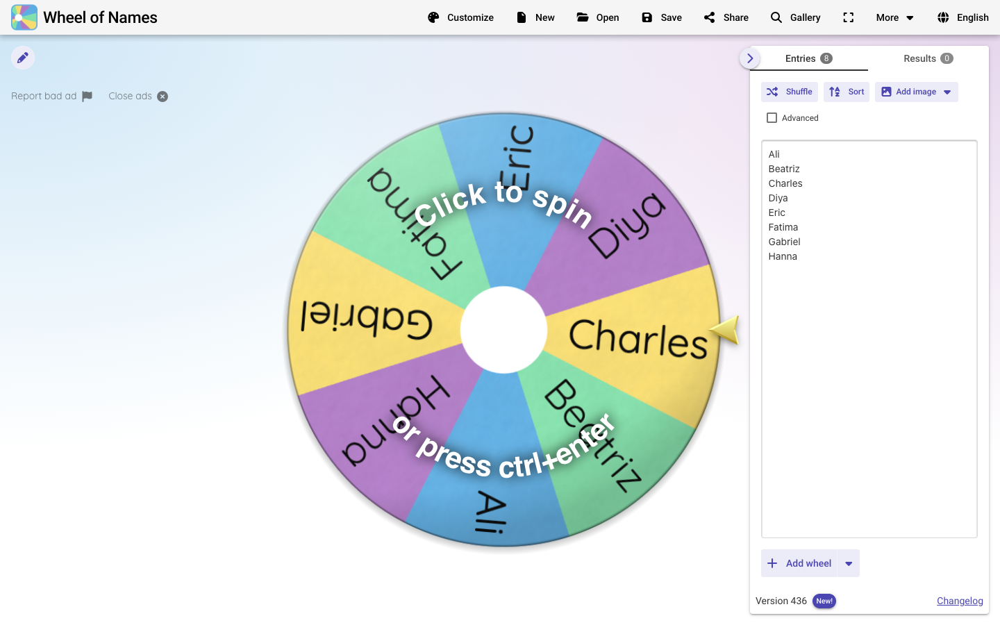
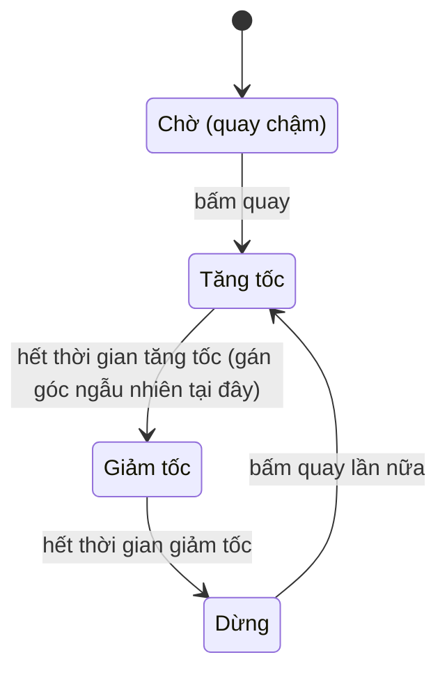
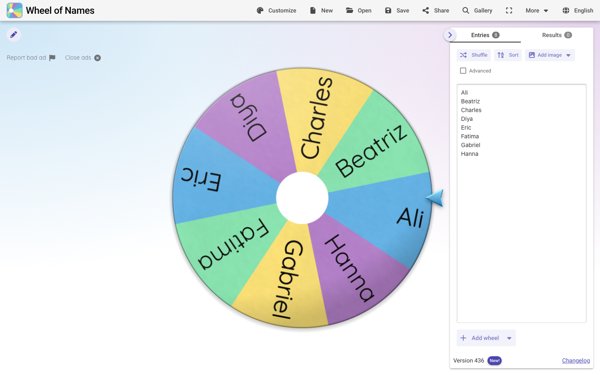
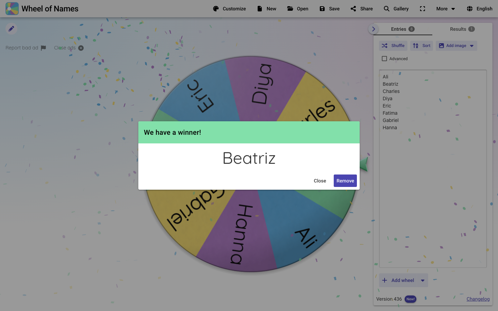

# Dịch ngược wheelofnames.com bằng REA

> **Ngày phân tích:** 15/10/2026 · **Bản site:** v436 · **Công cụ:** [REA](https://github.com/morluto/rea) 6.5.0, build từ mã nguồn (commit `6fcfc5b`)
>
> **Phạm vi:** chỉ phía trình duyệt. Không đăng nhập, không gọi API riêng tư hay quản trị. Tổng lưu lượng tạo ra: 3 lần tải trang và 1 lần gọi `GET /api/v3/client-settings`.
>
> **Lưu ý:** đây là phân tích độc lập, không liên kết với Wheel of Names. Repo không chứa mã nguồn, âm thanh hay hình ảnh gốc của trang (trừ ảnh chụp màn hình minh hoạ). Mọi mô tả thuật toán đều do tôi viết lại bằng lời.



## Tóm tắt nhanh

1. **Công nghệ:** ứng dụng một trang (SPA) viết bằng Vue 3 + Quasar + Pinia + vue-router + vue-i18n. Build bằng Vite/Rolldown thành 49 chunk JS và 2 script inline (tổng khoảng 927 KB). **Không có source map.**
2. **Bánh xe** là một `<canvas>` 700×700 vẽ bằng Canvas 2D. Vật lý chạy theo **bước cố định 60 tick/giây**, không phụ thuộc tần số quét màn hình.
3. **Trình duyệt tự quyết định người thắng**, chỉ gọi `crypto.getRandomValues` **đúng 1 lần** cho mỗi lượt quay. Ở giây thứ 1, khi bánh xe đang quay khoảng 5,8 vòng/giây, góc của nó bị **gán lại thành một góc ngẫu nhiên** (mắt người không thấy được). 9 giây giảm tốc sau đó đã được tính trước hoàn toàn.
4. **Lúc quay không có request nào tới server** để quyết định kết quả. Trang chỉ tải file âm thanh và gửi sự kiện GA4 `SpinWithDefaultNames`.
5. **Backend** là REST `/api/v3/*` (lưu và chia sẻ bánh xe, gallery, API key cho lập trình viên, ảnh thu nhỏ, proxy Unsplash). Đăng nhập bằng **Firebase Authentication**. Có thể nhập danh sách tên từ **Google Sheets**.
6. **Nguồn thu từ quảng cáo:** 1 lần tải trang + 1 lượt quay sinh ra **1.653 request tới 260 domain**. Chỉ **75** request là của wheelofnames.com, phần còn lại là đấu giá quảng cáo (Freestar/Prebid) và đồng bộ cookie.

---

## 1. Phương pháp: REA đã chạy những gì

Chrome headless chạy với profile riêng, cổng gỡ lỗi 9222 chỉ mở trên `127.0.0.1`. REA gắn vào qua Chrome DevTools Protocol.

| # | Lệnh REA | Kết quả chính | Evidence ID |
|---|---|---|---|
| 1 | `list-browser-targets` | Tìm được tab wheelofnames.com | `ev_5739fb69…` |
| 2 | `inspect-web-page` (kèm mã script, cây accessibility, console, tên khoá storage) | 51 script của origin chính, 63 tài nguyên. 27 script bên thứ ba bị lọc vì khác origin | `ev_e0ecc809…` |
| 3 | `export-web-scripts` | Xuất 51 file để phân tích tĩnh | `ev_f7b8f7ad…` |
| 4 | `analyze-javascript-application` | Đồ thị module của 51 file: 284.269 nút AST, 2.497 phát hiện (bản đầy đủ 224 MB, tôi đọc qua view tóm tắt) | `ev_5bf2b6ce…` → view `ev_64295c27…` |
| 5 | `analyze-web-bundle` | Nhận diện được Vue và runtime Vite (độ tin cậy medium) | `ev_c60a4743…` |
| 6 | `capture-browser-scenario` ×2 | Mở trang → đợi bánh xe → bấm quay → chờ. Có ảnh từng bước và toàn bộ nhật ký mạng | `ev_1663cb4f…`, `ev_de851bd8…` |
| 7 | `observe-web-execution` | Đo số lần chạy từng hàm (V8 coverage) trong 18 giây quanh một lượt quay, bấm quay bằng Ctrl+Enter | `ev_567d8241…` |

Lệnh `recover-javascript-sources` của REA cần Wakaru bản Linux x64 nên không chạy được trên macOS. Vì vậy tôi định dạng lại mã bằng `oxfmt` (có sẵn trong REA) để đọc.

Các file Evidence gốc ở trên chứa nguyên văn mã của trang, nên chỉ được giữ trên máy phân tích và không có trong repo công khai. Có thể tạo lại bằng các lệnh ở mục 10.

## 2. Kiến trúc và công nghệ

| Lớp | Công nghệ | Căn cứ | Độ tin cậy |
|---|---|---|---|
| UI | Vue 3 | file `runtime-core.esm-bundler`, REA nhận diện "Vue" | cao |
| Bộ component | Quasar | các chunk `QBtn`, `QLayout`, `QSelect`, `QMenu`, `QTabPanels`, `TouchPan`… | cao |
| State | Pinia | chuỗi `pinia`/`$pinia` trong chunk `stores` | cao |
| Router | vue-router | chunk `use-router-link` | cao |
| Đa ngôn ngữ | vue-i18n; gói ngôn ngữ chỉ tải khi cần (`en-US-v436.js`, `/api/v3/languages`) | dấu hiệu `__VUE_I18N…` | cao |
| Build | Vite + Rolldown; tên chunk gắn số phiên bản `-v436`, CSS có hash | `rolldown-runtime`, `__vite__mapDeps`, REA nhận diện "Vite" | cao |
| Âm thanh | howler.js (Web Audio, dự phòng bằng HTML5 Audio) | các chuỗi `Howler`, `_howls` | cao |
| Pháo giấy | canvas-confetti chạy trong Web Worker với OffscreenCanvas | `disableForReducedMotion`, `particleCount`; worker `blob:` xuất hiện lúc quay xong | cao |
| Tài khoản | Firebase Authentication (email/mật khẩu, đặt lại mật khẩu) | endpoint `accounts:signInWithPassword`…, cấu hình Firebase | cao |
| Google Sheets | gapi + Sheets API v4, scope `spreadsheets.readonly` và `drive.file` | chunk `SheetPicker` | cao |
| Font | Quicksand (Google Fonts), Font Awesome | nhật ký mạng | cao |
| Đo lường | GA4 (`gtag`); gửi thêm số lõi CPU, dung lượng RAM và phiên bản trình duyệt làm thuộc tính người dùng | script inline đầu trang | cao |
| Quảng cáo | Freestar (Prebid.js 11.32), Amazon APS, Google Ad Manager, video Primis; trình quản lý đồng ý Google Funding Choices | nhật ký mạng | cao |

Không tìm thấy Firestore trong bundle. Mọi dữ liệu đều đi qua API riêng `/api/v3`.

### Các component chính (lấy từ `__name` của Vue)

- `EditWheelPage`: trang chính. `AppToolbar` chứa Customize / New / Open / Save / Share / Gallery / Toàn màn hình / More / chọn ngôn ngữ.
- `SpinningWheel` + `WheelOverlayText`: canvas bánh xe và dòng chữ uốn cong "Click to spin / or press ctrl+enter". Bán kính đường cong được chỉnh riêng cho từng ngôn ngữ có chữ dài.
- `EditorColumn` gồm `BasicEditor` (ô nhập văn bản), `AdvancedEditor`/`AdvancedEntry` (trọng số, màu, ảnh cho từng mục), `EditorButtons` (Shuffle, Sort, Add image), `MultiWheelControls` (nhiều bánh xe) và `ResultsTextbox`.
- `CustomizeDialog`: chọn âm thanh lúc quay và sau khi quay, theme, loại bánh xe, ảnh trung tâm, ảnh nền, tìm ảnh qua `UnsplashDialog`.
- `WinnerDialog` (kèm `WinnerAnimation`) và `ConfettiLauncher`.
- Lưu và chia sẻ: `SaveWheelWorkflow`, `SaveCloudDialog`, `SaveLocalDialog`, `ShareWizardDialog`, `ShareDialogLink`, `OpenWheelWorkflow`, `MyWheelsDialog`, `SheetConfigDialog`, `SheetLoginDialog`.
- `AboutCards`: các thẻ giới thiệu (độ ngẫu nhiên, quảng cáo, quyền riêng tư, streaming…).

## 3. Cốt lõi: bánh xe quay như thế nào

### 3.1 Vòng lặp

- **Ba cách bắt đầu quay:** bấm hoặc chạm vào canvas, nhấn **Ctrl+Enter**, hoặc gửi `window.postMessage({ name: "spin" })` vào trang. Cách thứ ba dành cho trường hợp nhúng iframe hoặc dùng công cụ livestream.
- **Bước thời gian cố định (fixed timestep):** mỗi khung `requestAnimationFrame` cộng dồn thời gian đã trôi qua. Cứ đủ 1/60 giây thì chạy 1 tick vật lý, sau đó mới vẽ. Nhờ vậy bánh xe quay giống hệt nhau trên màn hình 60 Hz hay 120 Hz.
- **Trạng thái bất biến:** mỗi tick tạo ra một object trạng thái mới bằng cách cho trạng thái cũ đi qua một chuỗi hàm thuần. Thứ tự: cộng góc theo tốc độ → xử lý theo pha hiện tại → tính ô nằm dưới kim → (nếu có hơn 1.000 mục) trượt cửa sổ hiển thị → tăng bộ đếm tick.

### 3.2 Máy trạng thái 4 pha



Với cấu hình mặc định (`spinTime = 10` giây):

| Pha | Thời lượng | Tốc độ góc | Số vòng quay được |
|---|---|---|---|
| Chờ | đến khi bấm | 0,005 rad/tick ≈ 17°/s | — |
| Tăng tốc | min(1 s, spinTime/3) = **60 tick** | mỗi tick +0,01 rad/tick (chế độ "slow spin": +0,001). Đỉnh **0,61 rad/tick ≈ 5,8 vòng/s** | ≈ 3 |
| **Chốt kết quả** | 1 tick | góc được gán lại = U × 2π, với U lấy từ `crypto.getRandomValues` | — |
| Giảm tốc | spinTime − 1 s = **540 tick** | mỗi tick nhân với 0,98471 (giảm theo hàm mũ), từ 0,61 xuống 0,00015 rad/tick | ≈ 6,35 |
| Dừng | — | 0 | gọi hàm báo người thắng |

Hệ số giảm tốc được tính trước sao cho tốc độ chạm đúng ngưỡng 0,00015 rad/tick ở đúng tick cuối cùng. Vì vậy **tổng thời gian quay luôn bằng đúng `spinTime`**, dù người dùng đặt bao nhiêu giây.

### 3.3 Cách chọn người thắng

- **Số ngẫu nhiên:** lấy một số nguyên 32 bit từ `crypto.getRandomValues` rồi chia cho 2³² − 1, được U ∈ [0, 1].
- **Gán lại góc:** ở tick chuyển từ tăng tốc sang giảm tốc, góc bánh xe **bị ghi đè** bằng U × 2π. Lúc này bánh xe đang quay gần 6 vòng/giây nên không ai thấy cú "nhảy" đó.
- **Phần còn lại đã định sẵn:** góc dừng = (U × 2π + C) mod 2π. C là quãng đường của pha giảm tốc, là hằng số khi `spinTime` cố định. Do đó góc dừng **phân bố đều** trên cả vòng tròn.
- **Đổi góc ra mục trúng:** kim nằm ở **vị trí 3 giờ** (bên phải bánh xe).
  - Chế độ thường: chỉ số mục = làm tròn(góc ÷ (2π/n)) mod n.
  - Chế độ Advanced: mỗi ô rộng 2π × trọng số ÷ tổng trọng số; tra mục theo các biên cộng dồn.
- **Kết luận:** xác suất trúng = **1/n** ở chế độ thường, hoặc **trọng số ÷ tổng trọng số** ở chế độ Advanced. Điều này khớp với đoạn "Guarantee Randomness" mà chính trang tự giới thiệu.

**Kiểm chứng lúc chạy thật** (`observe-web-execution`, `ev_567d8241…`). Cửa sổ đo dài 18 giây, bao trọn 1 lượt quay:

| Hàm | Số lần chạy | Ý nghĩa |
|---|---|---|
| Hàm lấy số ngẫu nhiên bằng `crypto` | **1** | đúng 1 lần cho mỗi lượt quay |
| Xử lý tick ở pha Chờ | 32 | khoảng 0,5 giây trước khi bấm |
| Xử lý tick ở pha Tăng tốc | **62** | 60 tick + các tick chuyển pha |
| Xử lý tick ở pha Giảm tốc | **541** | 540 tick + tick chuyển pha |
| Tính hệ số giảm tốc | 540 | khớp đúng 540 tick |
| Xử lý tick ở pha Dừng | 418 | khoảng 7 giây còn lại của cửa sổ đo |
| `click` / `getEntryAtAngle` | 1 / 1 | 1 lần bấm, 1 lần xác định người thắng |

Tổng 32 + 62 + 541 + 418 = 1.053 tick ≈ 17,5 giây ở tốc độ 60 tick/s, khớp với cửa sổ đo 18 giây.

**Mô phỏng độc lập** (`cong-cu/spin-model.mjs`, tôi tự viết lại từ các tham số đo được): quay 200.000 lần với 8 tên, mỗi tên trúng 12,41–12,63% (lý thuyết là 12,5%).

Một vài chi tiết phụ:

- **Nút Shuffle** dùng `Math.random` (thuật toán Fisher–Yates), không dùng `crypto`. Nút này chỉ đổi thứ tự hiển thị, không ảnh hưởng xác suất trúng.
- **Khi có hơn 1.000 mục:** bánh xe chỉ vẽ 1.000 ô. Lúc bắt đầu quay, điểm đầu của cửa sổ hiển thị được chọn ngẫu nhiên (cũng bằng `crypto`). Trong khi quay, cửa sổ trượt dần qua danh sách. Một tấm "kim loại xước" che vùng đổi tên ở phía đối diện kim nên người xem không thấy tên bị thay.
- **Khi tắt `allowDuplicates`:** các mục trùng nhau (cùng chữ và cùng ảnh) được gộp làm một.



### 3.4 Kỹ thuật vẽ

Mỗi khung hình vẽ chồng nhiều lớp. Phần lớn các lớp được **lưu sẵn vào canvas phụ**, nên mỗi khung chỉ còn vài lệnh `drawImage`:

1. Xoá nền, vẽ bóng đổ của bánh xe (lưu sẵn).
2. Ảnh phủ, nếu là bánh xe kiểu ảnh.
3. **Toàn bộ các ô và chữ** được vẽ một lần vào canvas phụ. Mỗi khung chỉ cần xoay canvas đó rồi `drawImage`. Chỉ vẽ lại khi danh sách hoặc cấu hình thay đổi.
4. Viền vát, bóng chuyển màu hình nón (conic) ở viền, bóng mặt và ánh sáng từ trên xuống để tạo cảm giác 3D.
5. Kim chỉ (lưu sẵn theo màu). Nếu có từ 80 mục trở xuống, kim **đổi màu theo ô đang chỉ**.
6. Hình tròn hoặc ảnh ở tâm. Có các cỡ XS đến XXL, bằng 1–60% bán kính; mặc định là S = 20%.
7. Tấm che (chỉ khi có hơn 1.000 mục) và watermark.

Ngoài ra:

- Chữ được căn phải sát mép ngoài. Cỡ chữ tự co theo tên dài nhất và độ rộng của ô.
- Màu chữ (đen hoặc trắng) được chọn theo độ sáng tương đối chuẩn WCAG, ngưỡng 0,179.
- Một lớp texture nhiễu mờ 15% phủ lên mặt bánh xe để tạo cảm giác có chất liệu.
- Khi trang bị nhúng trong iframe, một watermark SVG "wheelofnames.com" uốn cong sẽ hiện lên.

### 3.5 Sau khi bánh xe dừng

- **Âm "tích tắc"** phát mỗi khi kim chuyển sang ô mới (gắn với sự kiện đổi ô, không theo thời gian). File âm thanh chỉ tải khi cần: `ding.mp3` chỉ được tải ở lần quay đầu tiên.
- **Âm sau khi quay:** mặc định là tiếng vỗ tay nhẹ. Thư viện có hơn 160 file nhạc và hiệu ứng (nhạc có bản quyền từ Shutterstock, Kevin MacLeod…). Có thể chọn **đọc to tên người thắng** bằng Web Speech API (2 giọng, chỉnh được âm lượng).
- **Hộp thoại "We have a winner!"** có nút Close và Remove (xoá người thắng khỏi danh sách). Có thêm tuỳ chọn nút Hide và tự động xoá người thắng. Tab Results ghi lại kết quả.
- **Pháo giấy** do canvas-confetti vẽ trong worker.
- **Sự kiện GA4** `SpinWithDefaultNames` được gửi kèm phiên bản app. Tên sự kiện cho thấy đây là loại dành cho lượt quay với danh sách mặc định; tôi chưa thử với danh sách khác.



## 4. Mô hình dữ liệu của một bánh xe (giá trị mặc định)

| Trường | Mặc định | Ý nghĩa |
|---|---|---|
| `entries[]` | 8 tên mẫu | mỗi mục gồm `text`, `image` (data URI), `color`, `weight`, `enabled`, `id` |
| `type` | `color` | `color` hoặc `image` |
| `spinTime` | 10 | thời gian quay (giây) |
| `slowSpin` | false | tăng tốc chậm |
| `maxNames` | 1000 | số ô tối đa được vẽ |
| `allowDuplicates` | true | cho phép mục trùng |
| `isAdvanced` | false | bật trọng số, màu riêng cho từng mục |
| `hubSize` | `S` | cỡ hình tròn ở tâm |
| `pointerChangesColor` | true | kim đổi màu theo ô |
| `hideEntryText` | `never` | `never` / `on-image` / `always` |
| `drawOutlines` / `drawShadow` | false / true | viền ô / bóng đổ |
| `launchConfetti` / `animateWinner` | true / false | hiệu ứng khi thắng |
| `displayWinnerDialog`, `displayRemoveButton`, `displayHideButton` | true | hộp thoại người thắng |
| `autoRemoveWinner` | false | tự xoá người thắng |
| `duringSpinSound` / `duringSpinSoundVolume` | `ticking-sound` / 50 | âm thanh lúc quay |
| `afterSpinSound` / `afterSpinSoundVolume` | `applause-sound-soft` / 50 | âm thanh sau khi quay |
| `winnerMessage`, `centerText`, `title`, `description`, `showTitle`, `font` | rỗng / true | nội dung hiển thị |
| `pictureType`, `galleryPicture`, `customPictureDataUri` | `none` | ảnh ở tâm |
| `coverImageType`, `customCoverImageDataUri`, `pageBackgroundColor`, `colorSettings[]` | — | ảnh phủ, màu nền, bảng màu ô |

## 5. Lưu trữ, tài khoản và chia sẻ

- **localStorage của chính app** chỉ có 2 khoá:
  - `Preferences`: chế độ tối, vị trí bánh xe, hiện/ẩn lớp chữ phủ, gợi ý ngôn ngữ, phiên bản đã xem…
  - `LastWheelGroup`: nhóm nhiều bánh xe gần nhất (chỉ xuất hiện khi dùng nhiều bánh xe).

  Trong lần đo, 51 khoá còn lại đều do script quảng cáo và đo lường bên thứ ba ghi (ID5, pubcid, IntentIQ, Lotame, Amazon…).
- **Đăng nhập:** dùng Firebase. Sau khi đăng nhập, ID token được gửi trong header `Authorization` mỗi khi gọi `/api/v3`.
- **Chia sẻ:** `POST /api/v3/wheels` trả về một `path`. Đó chính là link chia sẻ dạng `wheelofnames.com/<path>`.
- **Bộ đếm "Activity in 2026"** (số lượt quay, số giờ quay) **không phải số đếm thật theo thời gian thực**. Trang lấy hai tỉ lệ `spinsPerSecond` và `hoursSpunPerSecond` từ `client-settings`, rồi tự nhân với số giây đã trôi qua kể từ ngày 1/1.

## 6. API `/api/v3` (đọc từ bundle)

Mọi phản hồi có dạng `{ data: … }` hoặc `{ error: "…" }`. Nếu server trả về HTML, client coi đó là lỗi.

| Nhóm | Endpoint | Ghi chú |
|---|---|---|
| Cấu hình | `GET client-settings` | gọi khi tải trang. Trả về `advertiserWeights.freestar`, `spinsPerSecond`, `hoursSpunPerSecond`, `maintenanceMessage`, `commitHash` |
| Bánh xe | `POST wheels` (trả về `path`); `GET/PUT/DELETE wheels/{path}`; `GET wheels`, `wheels/shared`, `wheels/private`; `PUT wheels/private`; `POST wheels/change-owner`; `GET wheels/thumbnails/{path}?size&lastWrite` | các thao tác ghi cần token |
| Người dùng | `GET users` (có cờ `premium`), `POST users`, `DELETE users` | |
| API key cho dev | `GET/POST/DELETE api-keys`; khi gọi API dùng header `x-api-key` | |
| Gallery | `GET gallery?search&pageNumber`, `GET gallery/suggestions` | |
| Ảnh | `GET unsplash-proxy/search/photos?…` | đi qua proxy để khoá Unsplash nằm ở server |
| Ngôn ngữ | `GET languages` | |
| Quản trị | khoảng 17 đường dẫn `admin/*`: hàng đợi duyệt gallery và bánh xe chia sẻ, quản lý người dùng, chuyển bánh xe, danh sách từ cấm, dịch | giao diện admin nằm sẵn trong bundle công khai, nên việc kiểm tra quyền phải làm ở server. **Tôi không gọi thử endpoint nào trong nhóm này.** |

## 7. Quảng cáo và quyền riêng tư (đo thực tế)

- Đo trong 1 lần tải trang + 1 lượt quay:
  - **1.653 request** tới **260 domain**; chỉ **75** request là của wheelofnames.com.
  - Phần lớn còn lại là đấu giá quảng cáo và đồng bộ cookie: doubleclick, pubmatic, rubicon, openx, criteo, amazon-adsystem, inmobi, 3lift…
- Dữ liệu lưu trên máy:
  - **22 cookie**: GA, Freestar, IntentIQ, ID5, Lotame, Google Ads…
  - **52 khoá localStorage**, trong đó chỉ `Preferences` là của app.
  - **11 khoá sessionStorage**, đều do script bên thứ ba ghi (9 khoá có tiền tố `fs.` của Freestar). Mã của chính app không đụng tới sessionStorage.
- Trang có nút "Close ads" để tắt quảng cáo trong phiên hiện tại.

## 8. Giới hạn của phân tích

- **Chỉ phía client.** Logic server (tạo link chia sẻ, kiểm duyệt nội dung, lưu trữ) chưa biết.
- **Không có source map** và tên hàm đã bị rút gọn. Tên component lấy từ thuộc tính `__name` của Vue. Tên thư viện được nhận diện qua chuỗi đặc trưng.
- **Một vài bộ đếm không đồng nhất.** Số lần chạy đo được của một số hàm phụ không khớp nhau, do giới hạn của V8 khi đo ở mức hàm với những hàm đã biên dịch từ trước. Các số quan trọng (hàm ngẫu nhiên chạy 1 lần, số tick của từng pha) đều khớp với mô hình.
- **Chưa thử các luồng cần đăng nhập** (lưu lên cloud, chia sẻ, Google Sheets), vì không đăng nhập.

## 9. Nếu muốn làm một sản phẩm tương tự

Ý tưởng và thuật toán có thể dùng lại. **Mã nguồn, âm thanh, hình ảnh và thương hiệu "Wheel of Names" thuộc về họ**, nên cần tự viết code và dùng tài nguyên của mình. Các bài học kỹ thuật rút ra:

1. Dùng vòng lặp vật lý 60 Hz với bước thời gian cố định, tách riêng khỏi việc vẽ bằng `requestAnimationFrame`.
2. Vẽ sẵn các ô vào canvas phụ; mỗi khung chỉ xoay rồi `drawImage` để luôn đạt 60 fps kể cả khi có 1.000 ô.
3. Chỉ lấy số ngẫu nhiên bằng `crypto` một lần cho mỗi lượt quay.
   - Cách của họ: gán lại góc khi bánh xe đang quay nhanh.
   - Cách minh bạch hơn: chọn người thắng trước, rồi tính góc đích và dùng đường cong giảm tốc để dừng đúng chỗ.
4. Giảm tốc theo hàm mũ, với hệ số tính sẵn để tổng thời gian quay luôn đúng như cài đặt.
5. Phát âm "tích" theo sự kiện kim đổi ô (không theo đồng hồ), cho kim đổi màu theo ô, tự co cỡ chữ, chọn màu chữ theo độ sáng nền.
6. Hỗ trợ phím tắt và `postMessage` để nhúng vào trang khác hoặc dùng khi livestream.

## 10. Chạy lại phân tích

Cần Node.js 22.19+/24.11+ và Google Chrome. Các lệnh dưới đây viết cho macOS và chạy từ thư mục gốc của repo này.

```bash
# 1. Cài REA từ mã nguồn (chỉ cần làm một lần)
git clone https://github.com/morluto/rea.git ~/Documents/GitHub/rea
(cd ~/Documents/GitHub/rea && npm ci && npm run build:cached)
export REA_DIR=~/Documents/GitHub/rea          # click-spin.mjs cũng đọc biến này
REA="node $REA_DIR/scripts/rea.mjs"
CHROME="/Applications/Google Chrome.app/Contents/MacOS/Google Chrome"
OUT="$PWD/out" && mkdir -p "$OUT"              # REA cần đường dẫn tuyệt đối

# 2. Chrome riêng, cổng gỡ lỗi chỉ mở trên loopback
"$CHROME" --headless=new --remote-debugging-port=9222 --user-data-dir="$OUT/chrome-profile" https://wheelofnames.com/ &
$REA list-browser-targets http://127.0.0.1:9222 --format json        # lấy TARGET_ID
$REA inspect-web-page http://127.0.0.1:9222 <TARGET_ID> --observation-ms 5000 --include-script-sources --format json > "$OUT/capture.json"
$REA export-web-scripts "$OUT/capture.json" "$OUT/exported" --format json
$REA analyze-javascript-application "$OUT/exported/files" --json > "$OUT/app.json"

# 3. Kịch bản tự bấm quay (REA tự mở và đóng trình duyệt)
$REA capture-browser-scenario cong-cu/kich-ban-quay.json --format json > "$OUT/scenario.json"

# 4. Đo số lần chạy từng hàm trong lúc quay (cần một tác nhân bên ngoài bấm quay)
$REA observe-web-execution http://127.0.0.1:9222 <TARGET_ID> --observation-ms 18000 --format json > "$OUT/exec.json" 2> "$OUT/exec.err" &
# đợi REA ghi "armed" vào exec.err rồi mới bấm quay
until grep -q armed "$OUT/exec.err" 2>/dev/null; do sleep 0.5; done
node cong-cu/click-spin.mjs

# 5. Mô phỏng độ công bằng (không cần mạng)
node cong-cu/spin-model.mjs
```

## Phụ lục: thư mục này

```
wheelofnames-re/
├── README.md                  ← giới thiệu ngắn
├── BAO-CAO.md                 ← báo cáo này
├── anh/                       ← ảnh chụp do REA ghi lại (trước, trong, sau khi quay, chế độ tối)
└── cong-cu/                   ← kịch bản REA, script bấm quay, mô hình mô phỏng (tự viết)
```

Trên máy phân tích còn hai thư mục `bang-chung/` (Evidence JSON gốc của REA) và `ma-nguon-tai-ve/` (script đã xuất và bản định dạng lại). Cả hai chứa mã của trang nên bị `.gitignore` loại khỏi repo. Bản đồ thị module đầy đủ (224 MB) cũng không được lưu; muốn có lại, chạy các lệnh ở mục 10.
